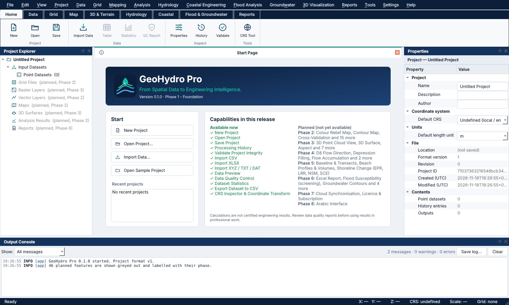

# GeoHydro Pro

**From Spatial Data to Engineering Intelligence.**

GeoHydro Pro is a scientific mapping, geospatial analysis, surface modelling, hydrology and
environmental engineering platform. This repository contains the **Phase 1 – Foundation**
release: a working Windows-targeted desktop application (PySide6/Qt) built on a shared,
UI-independent scientific engine and a versioned project file format.

> Status: pre-release development build (v0.1.0). Only the features listed as *implemented*
> in [docs/FEATURE_CHECKLIST.md](docs/FEATURE_CHECKLIST.md) exist. Everything else is shown
> in the interface as **planned** with its phase and cannot be triggered. Results are not
> certified engineering results.



## What works in Phase 1

* Desktop shell: 17-menu main menu, ribbon, Project Explorer, Properties panel (editable),
  Output Console (levels, filtering, save), status bar (cursor X/Y, nearest Z, CRS,
  on-screen scale, grid resolution, processing status), tabbed multi-document workspace.
* Import of **CSV, XLSX, XYZ, TXT, DAT** point data with auto-detection of delimiter,
  header, decimal separator (including decimal comma), encoding and worksheet; all
  overridable.
* Import wizard with parsed preview, raw source view, live point-location preview and
  quality control: missing values, missing-value tokens, NoData sentinels, non-numeric
  values, duplicate coordinates (exact or within a tolerance; keep, drop or average),
  geographic range checks. Multiple files per import.
* CRS assignment and validation via PyProj (any EPSG/WKT/PROJ definition), CRS inspector
  and single-point coordinate transformation.
* Dataset table, point preview, descriptive and spatial statistics, data-quality report.
* Project save/load in the versioned `.ghproj` format (SQLite): checksums, atomic writes,
  `.bak` backup, conflict detection (never silently replaces newer data), migration
  framework, processing history.
* Six synthetic sample datasets and a sample project.
* 88 automated tests (engine, storage, numerical checks, GUI).

## Quick start

```bash
python -m venv .venv
# Windows: .venv\Scripts\activate      Linux/macOS: source .venv/bin/activate
pip install -r requirements-dev.txt
pip install -e .
geohydro-pro --sample          # or: python -m geohydro.desktop
python -m pytest               # run the test suite
```

Full instructions, supported versions and hardware notes: [docs/INSTALL.md](docs/INSTALL.md).

## Repository layout

```
geohydro/
  engine/            shared scientific engine (no Qt imports)
    data/            readers, numeric parsing, QC, statistics, dataset model, import pipeline
    crs.py units.py  coordinate systems (PyProj) and measurement units
    capabilities.py  registry of implemented vs planned features (drives the UI)
    interpolation/ gridding/ mapping/ terrain/ visualization/
    hydrology/ coastal/ flood/ groundwater/      planned modules (empty, marked planned)
  project/           project model + .ghproj storage, migrations
  desktop/           PySide6 application (main window, widgets, dialogs, documents)
samples/             sample data generator, data/, sample_project.ghproj
tests/               pytest suite (engine, storage, GUI via pytest-qt)
tools/               make_screenshots.py (drives the real app offscreen)
docs/                architecture, project format, import methodology, checklist, log
web/ licensing/ payments/ reports/ website/ deployment/ database/   planned (README only)
```

## Dependencies

| Package | Purpose | Constraint |
|---|---|---|
| PySide6 (Qt 6.8 LTS) | desktop user interface | >=6.8, <6.11 |
| NumPy | numerical arrays | >=1.26, <3 |
| pandas | tabular data | >=2.1, <4 |
| SciPy | statistics, KD-trees, graph components | >=1.11, <2 |
| openpyxl | XLSX reading | >=3.1, <4 |
| PyProj (PROJ) | coordinate reference systems and transformations | >=3.6, <4 |
| Matplotlib | point previews (Qt backend) | >=3.8, <4 |
| pytest, pytest-qt, Pillow | tests and screenshots (development only) | see `requirements-dev.txt` |

Verified versions and platform notes: [docs/INSTALL.md](docs/INSTALL.md). GDAL, Rasterio,
GeoPandas, PyKrige, PyVista/VTK, FastAPI and the React/Three.js/MapLibre web stack are
introduced in the phases that need them.

## Platform status

* Linux: tests and offscreen application runs verified.
* Windows: automated tests run on GitHub Actions `windows-2022` (Windows Server 2022) and
  `windows-2025` (Windows Server 2025, the Windows 11 24H2 code base). See the latest run
  under *Actions*. Server images are strong evidence but are not desktop Windows 10/11; an
  interactive check on real Windows 10 and Windows 11 machines is still required before
  compatibility is declared.

## Development roadmap

| Phase | Scope | Status |
|---|---|---|
| 1 Foundation | architecture, desktop shell, project format, CSV/XLSX/XYZ import, preview, QC | **complete (v0.1.0)** |
| 2 Core mapping | gridding (IDW, Ordinary/Universal Kriging, Minimum Curvature, Natural/Nearest Neighbour, triangulation, RBF), variograms, cross-validation, contour / filled contour / colour relief / post maps, layout and export | planned |
| 3 3D and terrain | DEM/raster import, 3D surfaces (PyVista/VTK), hillshade, slope, aspect, curvature, profiles, cross-sections, volumes | planned |
| 4 Hydrology | DEM conditioning, D8, flow accumulation, streams, watersheds, catchment statistics | planned |
| 5 Coastal | shorelines, baselines, transects, EPR, LRR, NSM, SCE (DSAS-compatible calculations) | planned |
| 6 Advanced engineering | flood susceptibility screening, stormwater, groundwater and water quality, reports | planned |
| 7 Commercial platform | web application, accounts, cloud sync, licensing, subscriptions, payments, admin, website | planned |
| 8 Production release | validation campaign, security and performance testing, Windows installer, deployment | planned |

Each phase ends with working code, tests, screenshots, an updated feature checklist, known
limitations and next priorities.

## Documentation

* [Installation](docs/INSTALL.md)
* [Architecture](docs/ARCHITECTURE.md)
* [Project file format](docs/PROJECT_FORMAT.md)
* [Data import and QC methodology](docs/DATA_IMPORT.md)
* [Feature checklist](docs/FEATURE_CHECKLIST.md)
* [Test results](docs/TEST_RESULTS.md)
* [Development log](docs/DEVELOPMENT_LOG.md)

## Licence

Proprietary. All rights reserved. Third-party open-source dependencies keep their own
licences (PySide6/Qt under LGPLv3 — see INSTALL.md for the distribution implications).
