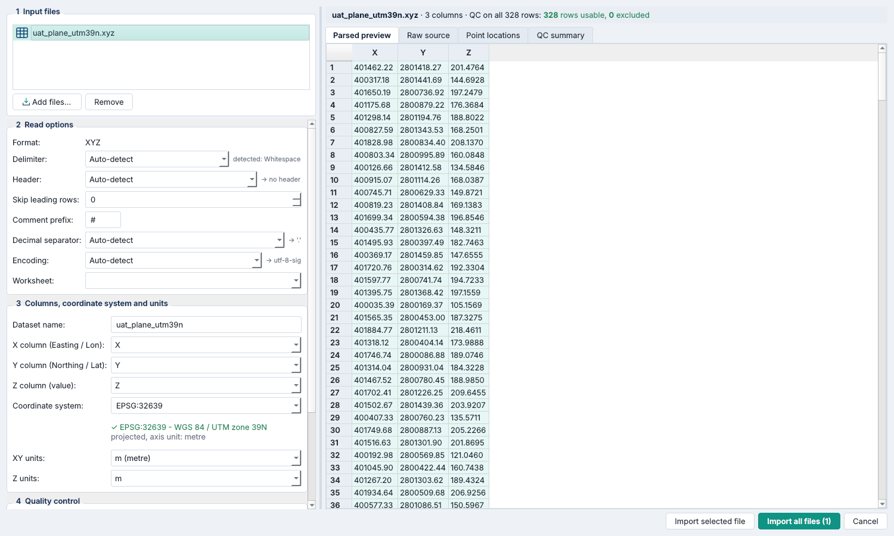
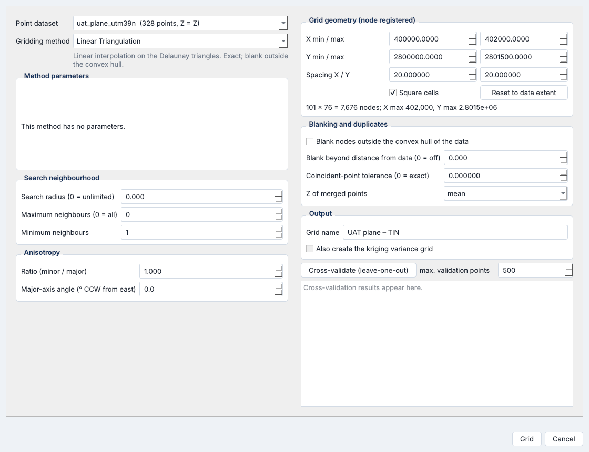
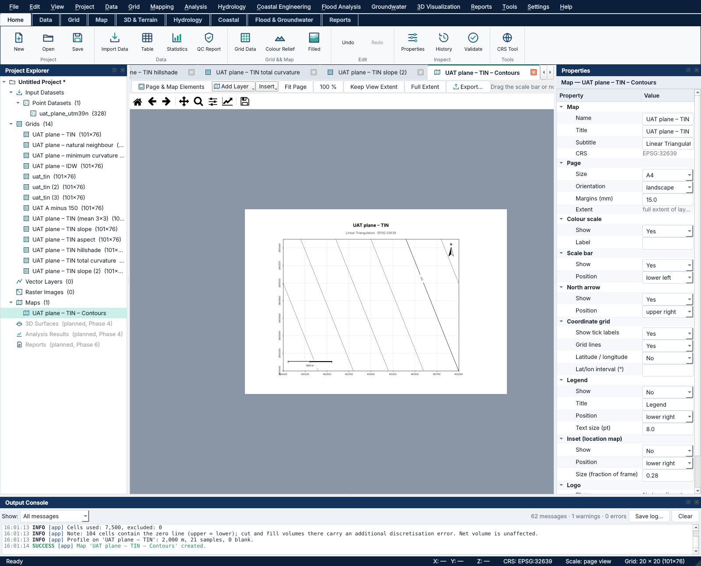
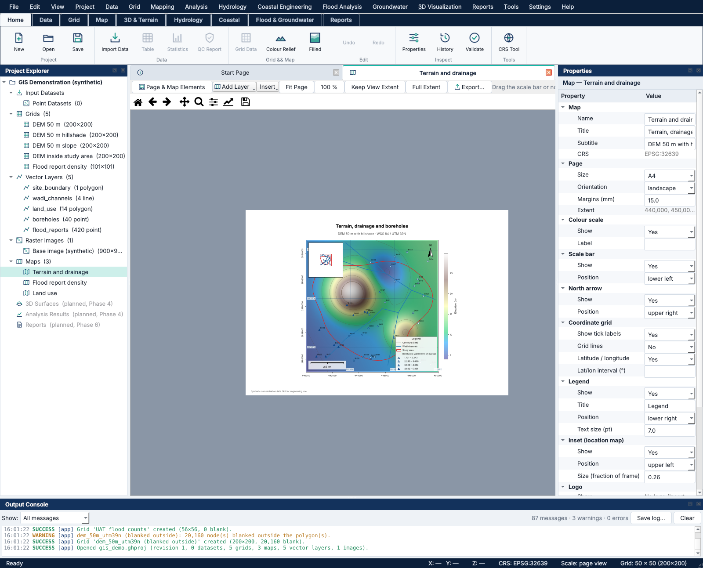

# GeoHydro Pro v0.3.0 — Quick Start Guide

From data to a finished map in about 15 minutes, using the sample file
`uat_plane_utm39n.xyz` from the installation package. Install first (Installation
Guide). All values below were produced by running these exact steps in GeoHydro Pro
0.3.0.

The sample dataset has 328 points (X, Y, Z in metres, no header) on an exact plane
`z = 100 + 0.05 (x − 400000) + 0.02 (y − 2800000)` in WGS 84 / UTM zone 39N
(`EPSG:32639`), over 2 km × 1.5 km. Because it is a plane, you can check the
results by hand.

## The main window

* **Menu bar and ribbon** (top): all commands. Items marked *(planned, Phase N)*
  are future features and are disabled.
* **Project Explorer** (left): datasets, grids, vector layers, raster images and
  maps of the project. Double-click to open; right-click for commands.
* **Properties** (right): settings of the selected item; edit them here.
* **Output Console** (bottom): every action, warning and error.
* **Edit ▸ Undo / Redo** (Ctrl+Z / Ctrl+Y) reverses the last actions.

## Step 1. New project

1. **File ▸ New Project**.
2. Click the project name in the Project Explorer. In **Properties** set
   **Coordinate system ▸ Default CRS** to `EPSG:32639`.
3. **File ▸ Save Project As…**, for example `Documents\GeoHydroPro\QuickStart.ghproj`.

## Step 2. Import the XYZ file

1. **File ▸ Import Data… ▸ Add files…** and choose `uat_plane_utm39n.xyz`.
2. The wizard detects the format: XYZ, whitespace delimiter, no header, columns
   X, Y, Z. Check that **Coordinate system** shows `EPSG:32639 - WGS 84 / UTM zone
   39N`. The top line says *328 rows usable, 0 excluded*.
3. Click **Import all files (1)**.

Result: `uat_plane_utm39n (328)` under *Point Datasets*. Double-click it to see the
**Table**, **Point Preview**, **Statistics** (Z from 100 to 230 m) and **Quality
Report**.

## Step 3. Make a grid

1. Select the dataset. **Grid ▸ Linear Triangulation**.
2. Under *Grid geometry* enter X min `400000`, X max `402000`, Y min `2800000`, Y max
   `2801500`, spacing `20`. The dialog shows *101 × 76 = 7,676 nodes*.
3. Name: `Plane TIN`. Click **Grid**.

Result: a grid with 0 blank nodes and Z from 100 to 230 m. Its document has
**Preview**, **Statistics** and **Method & Provenance** tabs.

Other methods are in the same menu (IDW, Ordinary and Universal Kriging, minimum
curvature, natural neighbour, nearest neighbour, radial basis functions).
Kriging needs a variogram first: **Grid ▸ Variogram Analysis**.

## Step 4. Contour map

1. Select `Plane TIN`. **Mapping ▸ Contour Map**.
2. The map page opens: straight, parallel contours every 20 m (120 … 220 m), 371 m
   apart, with title, north arrow, scale bar and coordinates.
3. Click **Page & Map Elements** to change the title, page size, legend, inset map,
   lat/lon graticule; click a layer to change its interval, colours and labels.
4. **Add Layer** adds more layers (for example a post map of the points); use the
   tick boxes, ▲ ▼ and opacity to arrange them.

## Step 5. Terrain analysis and volumes

| Command | Settings | Result for the sample |
|---|---|---|
| Analysis ▸ Slope | degrees | 3.08249° everywhere (outer ring of nodes blank) |
| Analysis ▸ Aspect | | 248.1986° (plane falls to the west-south-west) |
| Analysis ▸ Hillshade | 315°, 45° | constant 183.87 |
| Analysis ▸ Cut & Fill Volume | upper `Plane TIN`, level 0, trapezoidal | 495,000,000 m³ |
| Analysis ▸ Cut & Fill Volume | level 150 | net 45,000,000 m³ (cut 64,502,800, fill 19,502,800, with a warning about cells crossing the level) |
| Analysis ▸ Profiles | vertices `400000 2800750; 402000 2800750`, spacing 100 | 2,000 m, straight line from 115 m to 215 m; export to CSV |
| Grid ▸ Grid Calculator… | `A - 150`, A = `Plane TIN` | grid from −50 to 80 m |

Known display issue: a colour relief map of the slope grid shows a mottled pattern
instead of one colour, because the colour scale stretches tiny round-off
differences. The values are correct. This will be fixed in v0.3.1.

## Step 6. Export the map

With the map open: **File ▸ Export Map**. Choose PNG (300 dpi gives 3507 × 2480
pixels on A4 landscape), TIFF, PDF (fonts embedded, text selectable) or SVG.

## Step 7. Save and reopen

**File ▸ Save Project** (Ctrl+S). The `.ghproj` file holds the data, grids, maps and
the full processing history (**Project ▸ Processing History…**). **Project ▸
Validate Project** checks it.

## Next: GIS data

Open **File ▸ Open GIS Demo Project** to see vector layers, a base image, a DEM,
hillshade, slope and a flood-report density map together. To work with your own
GIS data:

* **File ▸ Import Vector…**: Shapefile, GeoJSON, GeoPackage, KML/KMZ, FlatGeobuf.
* **File ▸ Import Raster…**: GeoTIFF as a **Grid** (values for analysis) or an
  **Image** (base map).
* **Data ▸ Vector Processing…**: reproject, buffer, clip, dissolve, area/length,
  repair.
* **Mapping ▸ Point Density…**: kernel density or point counts (projected
  coordinates needed).
* **Mapping ▸ Add Vector / Image Layer…**, then set symbology (single,
  categorized, graduated) in Properties.

The sample GIS data are in
`C:\Users\<you>\AppData\Local\Programs\GeoHydro Pro\_internal\samples\data\gis\`.
All sample data are synthetic.

## Where to read more

**Help ▸ Documentation** opens the installed documentation folder: `GRIDDING.md`,
`MAPPING.md`, `GRID_MATH.md` (equations, assumptions, validation), `GIS.md`,
`WINDOWS_INSTALL.md`.

GeoHydro Pro 0.3.0 is a development pre-release and is not certified for
engineering use.
