# GeoHydro Pro v0.3.0 — User Acceptance Testing Guide

| | |
|---|---|
| Version under test | 0.3.0 (pre-release, tag `v0.3.0`, commit `aa2284f`) |
| Platform | Windows 10 or Windows 11, 64-bit, desktop (interactive) |
| Release files | `GeoHydroPro-0.3.0-Setup.exe`, `GeoHydroPro-0.3.0-win64.zip`, `GeoHydroPro-0.3.0-selftest.txt` |
| Test dataset | `uat_plane_utm39n.xyz` (§3) |
| Report | fill in `UAT_REPORT_TEMPLATE_v0.3.0` (§8) |

**Purpose.** This guide is the first interactive test of GeoHydro Pro on desktop
Windows. Until now the program has been tested only by automated tests on Windows
Server build machines (GitHub Actions). Your results decide whether the Windows
build can be called confirmed for Windows 10 and 11.

**How to use it.** Work through the sections in order. Each test case has an ID
(for example `GRD-02`), steps, and the expected result. Record **Pass**, **Fail** or
**Blocked** for each ID in the report template, with a note and a screenshot for
every Fail. Where a number is given, it was produced by running exactly these
steps through the real application (script `tools/uat_reference.py`, values in
`docs/uat/expected_values.json`). Screenshots in this guide were taken on Linux, so
fonts and window frames will look slightly different on Windows; the content
should match.

**What this test is not.** GeoHydro Pro 0.3.0 is a development pre-release. Passing
this test means the software behaves as documented on your machine. It does not
certify any result for engineering use.

## Contents

1. Installation on Windows 10/11
2. First-time setup
3. The test dataset
4. Test cases
5. Expected outputs (summary table)
6. Implemented versus planned features
7. Known limitations and troubleshooting
8. Acceptance report template

# 1. Installation on Windows 10/11

Full details: `docs/WINDOWS_INSTALL.md`, installed with the program and in the
repository.

### Requirements

* Windows 10 or 11, 64-bit (x64).
* About 500 MB of free disk space (the installed folder is 474 MB).
* No administrator rights are needed for a per-user installation.
* Recommended for the test: a screen of at least 1600 × 900 pixels.

### Download

From the GitHub release page **GeoHydro Pro v0.3.0**, download all three files:

| File | Size |
|---|---|
| `GeoHydroPro-0.3.0-Setup.exe` | 132.4 MB |
| `GeoHydroPro-0.3.0-win64.zip` | 199.8 MB |
| `GeoHydroPro-0.3.0-selftest.txt` | 1 KB (the build machine's self-test report) |

### Test cases

**INS-01 Installer starts.** Double-click `GeoHydroPro-0.3.0-Setup.exe`.

* Expected: Windows SmartScreen shows "Windows protected your PC", because the
  file is not code-signed. Click **More info**, confirm the file name, then **Run
  anyway**. The setup wizard opens and shows version 0.3.0.
* Record which Windows edition and build you use (Settings ▸ System ▸ About).

**INS-02 Per-user installation.** Choose **Install for me only**. Tick the desktop
shortcut and the `.ghproj` file association. Finish with "Launch GeoHydro Pro"
ticked.

* Expected: installation completes without errors into
  `%LOCALAPPDATA%\Programs\GeoHydro Pro`. The program starts and shows the start
  page (§2, screenshot `01_start_page.png`).

**INS-03 Start menu entries.** Open the Start menu and type "GeoHydro".

* Expected: four entries: **GeoHydro Pro**, **GeoHydro Pro (open sample
  project)**, **GeoHydro Pro (open GIS demo project)** and **GeoHydro Pro
  installation self-test**.

**INS-04 Installation self-test.** Run **GeoHydro Pro installation self-test**.

* Expected: after up to a minute, `GeoHydroPro-selftest.txt` appears in your
  Documents folder. Its last line is `RESULT: all checks passed`. It lists checks
  for the scientific libraries, PROJ, the sample project, gridding and export,
  GeoTIFF and GeoPackage input/output, the GIS demo project, and the main window.
* Attach this file to your report.

**INS-05 Sample projects open.** Start **GeoHydro Pro (open sample project)**,
close it, then start **GeoHydro Pro (open GIS demo project)**.

* Expected: the first opens a project with point datasets, grids and two maps.
  The second opens three maps: *Terrain and drainage*, *Flood report density*,
  *Land use* (screenshots `uat_08` to `uat_10`).

**INS-06 File association.** Save any project to the desktop (File ▸ Save Project
As…), close GeoHydro Pro, and double-click the `.ghproj` file.

* Expected: GeoHydro Pro opens that project.

**INS-07 Portable zip.** Unzip `GeoHydroPro-0.3.0-win64.zip` to a folder you can
write to (for example `Documents\GeoHydroPro-portable`). Run `GeoHydroPro.exe`
in it.

* Expected: the program starts without installation. Help ▸ About shows 0.3.0.

**INS-08 Uninstall and reinstall** (do this at the end of testing). Uninstall from
Settings ▸ Apps ▸ Installed apps (Windows 11) or Control Panel ▸ Programs and
Features (Windows 10).

* Expected: the program folder is removed; your saved projects are not touched.
  Reinstalling works.

# 2. First-time setup

**SET-01 Start page and layout.** Start GeoHydro Pro.

* Expected: the main window has a menu bar, a ribbon (Home, Data, Grid, Map, 3D &
  Terrain, Hydrology, Coastal, Flood & Groundwater, Reports), the **Project
  Explorer** on the left, **Properties** on the right, the **Output Console** at
  the bottom and a status bar. The start page offers new project, open project
  and the samples.

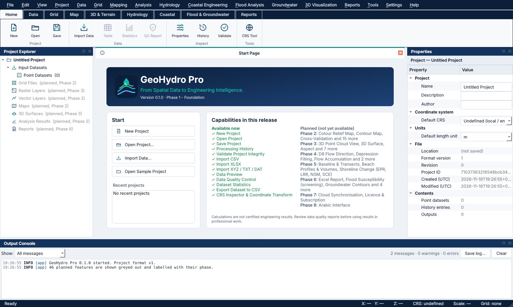

**SET-02 Display scaling.** Check that text and icons are readable at your
Windows display scaling (100 %, 125 % or 150 %).

* Expected: no clipped labels in the ribbon or dialogs. If anything is clipped,
  record the scaling and attach a screenshot.

**SET-03 Default units.** Open **Settings ▸ Default Length Unit**.

* Expected: metre, kilometre, centimetre, millimetre, international foot and US
  survey foot are listed; metre is ticked. Leave it on metre for this test.

**SET-04 New project and default CRS.** File ▸ New Project. Click the project
name at the top of the Project Explorer. In the Properties panel set
**Coordinate system ▸ Default CRS** to `EPSG:32639` (WGS 84 / UTM zone 39N). Set
the project name to `UAT v0.3.0`.

* Expected: the status bar shows `CRS: EPSG:32639`.

**SET-05 CRS tool.** Tools ▸ CRS Inspector & Transform…. Transform longitude 51.0,
latitude 25.3 from `EPSG:4326` to `EPSG:32639`.

* Expected: easting 500,000.00 m, northing 2,798,166.99 m (51° E is the central
  meridian of zone 39, so the easting is exactly the false easting).

**SET-06 Language.** Settings ▸ Language.

* Expected: English is ticked. *Arabic Interface (planned, Phase 8)* is shown but
  disabled.

# 3. The test dataset

`uat_plane_utm39n.xyz` is a plain text file with three space-separated columns
(X, Y, Z) and no header. It has **328 points** sampled from an exact plane:

```
z = 100 + 0.05 · (x − 400000) + 0.02 · (y − 2800000)        [metres]
CRS: EPSG:32639 (WGS 84 / UTM zone 39N)
extent: x 400000 – 402000 m, y 2800000 – 2801500 m (2 km × 1.5 km)
Z range: 100.0000 – 230.0000 m
```

It holds 300 random interior points (seed 20261120), the four corners and boundary
points every 250 m. Because the surface is a plane, most results have an exact
answer that you can check by hand:

| Quantity | Exact value | How it follows |
|---|---|---|
| Gradient | 0.053852 (5.3852 %) | √(0.05² + 0.02²) |
| Slope | 3.08249° | atan(0.053852) |
| Aspect (downslope direction, clockwise from north) | 248.1986° | the plane falls towards west-south-west |
| Curvature | 0 | a plane has no curvature |
| Volume above Z = 0 | 495,000,000 m³ | mean Z 165 m × 3,000,000 m² |
| Net volume above Z = 150 | 45,000,000 m³ | (165 − 150) m × 3,000,000 m² |
| Horizontal distance between 20 m contours | 371.4 m | 20 / 0.053852 |
| Profile along y = 2800750 from x = 400000 to 402000 | Z from 115 m to 215 m, straight line | |

**Where to get it.** The file is not inside the v0.3.0 installer (it was written
after the release was built). Download it from the repository folder
`samples/data/uat/` or from the files shared with this guide, and save it, for
example, to `Documents\GeoHydroPro-UAT\`.

The other test data are installed with the program in
`%LOCALAPPDATA%\Programs\GeoHydro Pro\_internal\samples\data\` (and
`...\samples\data\gis\` for the GIS data). All sample data are synthetic and
describe no real place.

# 4. Test cases

Work in the project created in SET-04 unless a step says otherwise. Save the
project (Ctrl+S) after each section.

## 4.1 Point data import and quality control

**IMP-01 Import the XYZ dataset.** File ▸ Import Data… ▸ Add files… ▸ select
`uat_plane_utm39n.xyz`.

* Expected (screenshot `uat_01`): format XYZ, delimiter detected as whitespace,
  no header; columns X, Y, Z; coordinate system `EPSG:32639 - WGS 84 / UTM zone
  39N`, projected, metre. The header line reads *3 columns · QC on all 328 rows:
  328 rows usable, 0 excluded*.
* Click **Import all files (1)**.
* Expected: the Project Explorer shows `uat_plane_utm39n (328)` under Point
  Datasets. The console reports a successful import.

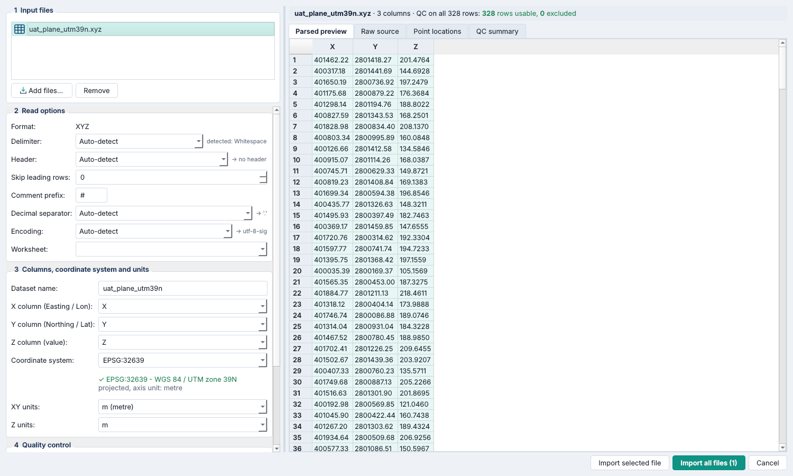

**IMP-02 Dataset views.** Double-click the dataset.

* Expected: tabs **Table** (328 rows), **Point Preview** (points fill a 2 × 1.5
  km rectangle, coloured from 100 to 230), **Statistics** (Z minimum 100.0000,
  maximum 230.0000) and **Quality Report** (0 excluded, 0 duplicates).

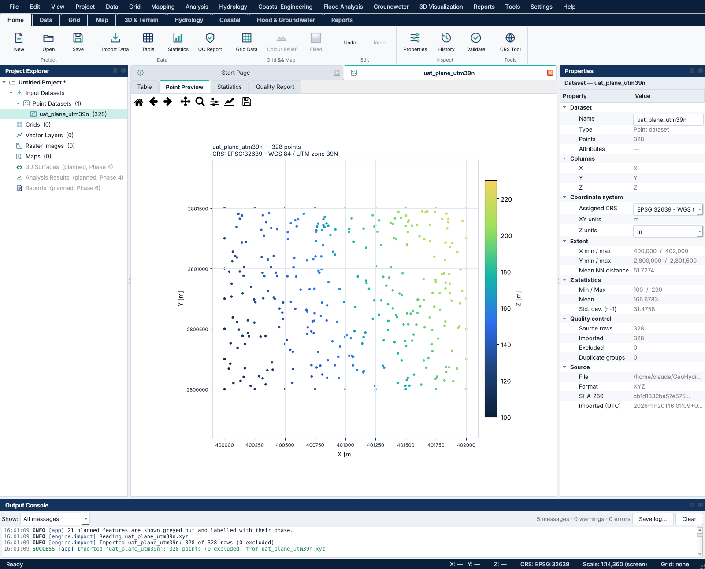

**IMP-03 Quality control on faulty data.** Import
`samples\data\field_readings_with_errors.csv` (semicolon delimiter and comma
decimal separator are detected automatically). Choose the project CRS.

* Expected: 40 source rows, **35 imported, 5 excluded**; 2 duplicate groups, one
  with conflicting Z values. The Quality Report tab explains each excluded row.

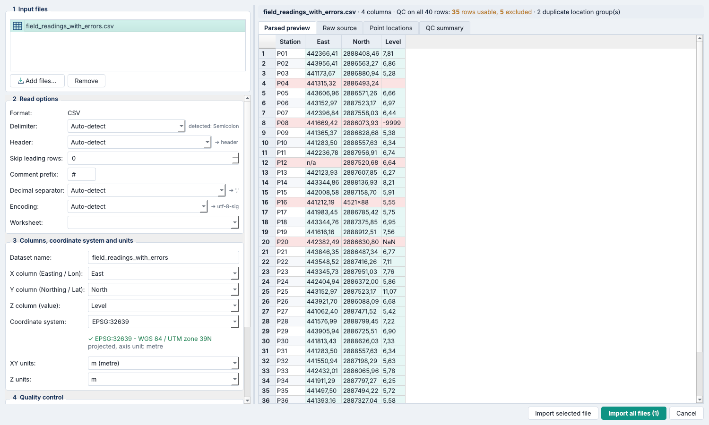

**IMP-04 Excel and geographic data.** Import `groundwater_wells.xlsx` (choose the
worksheet) and `stations_wgs84.dat` with CRS `EPSG:4326`, X = Longitude, Y =
Latitude, Z = SST_degC.

* Expected: the Excel file imports. The stations import gives **49 points** with
  XY units in degrees and **1 point reported out of range**.

**IMP-05 Export to CSV.** Select the UAT dataset, File ▸ Export Dataset to CSV….

* Expected: a CSV with 328 rows is written. Trying to overwrite the original
  source file is refused.

## 4.2 Gridding (Phase 2 features, regression check)

**GRD-01 Linear triangulation.** Select the UAT dataset. Grid ▸ Linear
Triangulation. In *Grid geometry* set X min 400000, X max 402000, Y min 2800000,
Y max 2801500, spacing 20 × 20 (square cells). Name the grid `UAT plane – TIN`.
Click **Grid**.

* Expected: the dialog shows *101 × 76 = 7,676 nodes*. The grid has 0 blank nodes,
  Z min 100.0000, Z max 230.0000. The grid document opens with Preview,
  Statistics and Method & Provenance tabs.

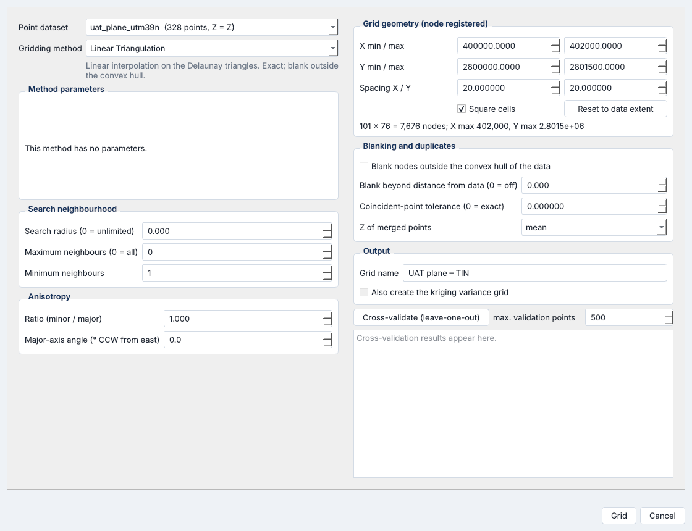

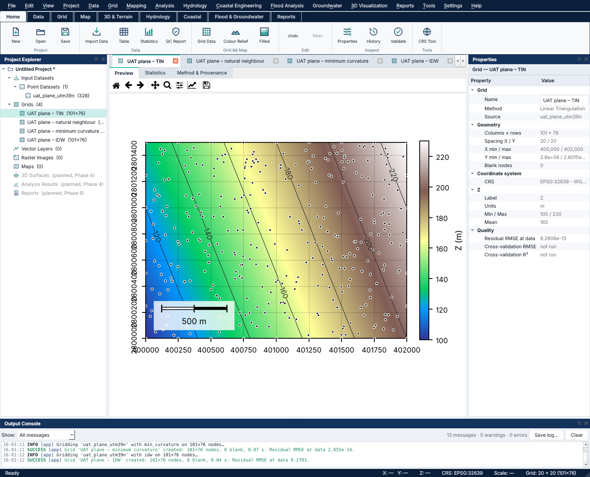

**GRD-02 Minimum curvature, natural neighbour and IDW.** Repeat GRD-01 with the
same geometry for **Minimum Curvature**, **Natural Neighbour** and **Inverse
Distance Weighting**, naming the grids accordingly.

* Expected: all three complete with 101 × 76 nodes and Z range 100 to 230. Their
  differences from the exact plane are checked in GM-02.

**GRD-03 Cross-validation.** Grid ▸ Cross-Validation on the UAT dataset with
Linear Triangulation, then click **Cross-validate (leave-one-out)**.

* Expected: 324 of 328 points compared, R² = 1.0000, RMSE below 10⁻¹⁰ m (measured
  3.6·10⁻¹² m). A warning says 4 points had no estimate: the four corners, which
  lie outside the hull once they are left out.

**GRD-04 Kriging with variogram.** Open the sample project (File ▸ Open Sample
Project; save your UAT project first). Select *Monitoring wells*. Grid ▸
Variogram Analysis: choose the spherical model and click auto-fit. Then Grid ▸
Ordinary Kriging, take the fitted variogram, tick *Also create the kriging
variance grid*, and grid.

* Expected: a kriging grid **and** a kriging variance grid are created; variance
  is lowest at the wells. A warning appears if the variogram fit hits a parameter
  bound. Return to your UAT project afterwards (File ▸ Recent Projects).

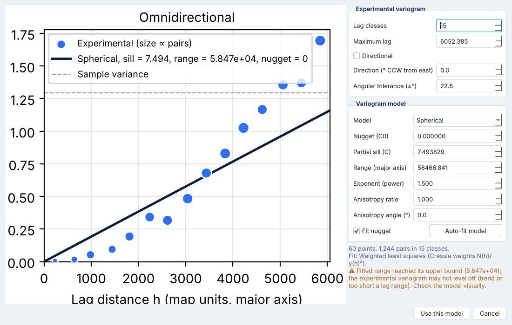

**GRD-05 Grid file export and re-import.** Select `UAT plane – TIN`. File ▸ Export
Grid File… three times: Surfer 7 binary (`.grd`), ESRI ASCII (`.asc`) and
GeoTIFF (`.tif`). Then File ▸ Open Grid File… for each.

* Expected: each reopened grid has 101 × 76 nodes and values identical to the
  original (GM-02 method: difference 0). The `.grd` and `.asc` files carry no CRS,
  so the project default CRS (`EPSG:32639`, set in SET-04) is applied and the grid
  records the warning *the CRS was set to the project default (grid files carry no
  CRS)*. The GeoTIFF carries `EPSG:32639` itself.

## 4.3 Grid mathematics and terrain analysis (new in v0.3.0)

**GM-01 Grid calculator.** Grid ▸ Grid Calculator…. Expression `A - 150`, Grid A
= `UAT plane – TIN`, result Z units `m`, name `UAT A minus 150`.

* Expected: a new grid with Z min −50.0000 and Z max 80.0000.

**GM-02 Exactness check by difference.** Grid Calculator with expression `A - B`,
A = `UAT plane – TIN`, B = each of the other grids from GRD-02 and GRD-05 in
turn. Read the result's Statistics tab.

* Expected (maximum absolute difference):

| B | Expected | Reason |
|---|---|---|
| Minimum curvature | < 0.000001 m (measured 2·10⁻¹¹) | both reproduce a plane exactly |
| Natural neighbour | ≈ 0.19 m at **one** node on the east edge, < 0.000001 m elsewhere | known defect, see §7.1 |
| IDW | up to about 7.7 m (RMSE about 1.7 m) | IDW does not reproduce planes; this is expected behaviour, not a fault |
| Re-imported `.grd`, `.asc`, `.tif` | exactly 0 | lossless file formats |

**GM-03 Filter.** Grid ▸ Filter Grid…, grid `UAT plane – TIN`, filter **mean**,
window 3, passes 1.

* Expected: a grid named `UAT plane – TIN (mean 3×3)`. Interior nodes are
  unchanged (a mean of a plane is the plane). Edge nodes change by up to 0.70 m,
  because the window is cut off at the edge (documented behaviour).

**GM-04 Slope.** Select `UAT plane – TIN`. Analysis ▸ Slope, units degrees.

* Expected: every interior node is **3.08249°** (constant to at least 9
  decimals). The outer ring of 350 nodes is blank, because the 3 × 3 window needs
  all neighbours.

**GM-05 Aspect.** Analysis ▸ Aspect.

* Expected: every interior node is **248.1986°**; 350 edge nodes blank.

**GM-06 Hillshade.** Analysis ▸ Hillshade with sun azimuth 315°, altitude 45°,
vertical exaggeration 1.

* Expected: a constant value of **183.87** (on the 0–255 scale) at every interior
  node.

**GM-07 Curvature.** Analysis ▸ Curvature, total.

* Expected: zero (|value| < 10⁻¹²) at every interior node.

**GM-08 Volumes.** Analysis ▸ Cut & Fill Volume. Upper surface `UAT plane – TIN`,
lower surface constant level 0, integration trapezoidal. Repeat with Simpson
and Simpson 3/8. Then level 150, trapezoidal.

* Expected:

| Case | Net volume | Cut | Fill | Other |
|---|---|---|---|---|
| level 0, all three rules | 495,000,000 m³ | 495,000,000 m³ | 0 | planar area 3,000,000 m²; surface area 3,004,346.85 m²; 7,500 cells used, 0 excluded |
| level 150, trapezoidal | **45,000,000 m³** | 64,502,800 m³ | 19,502,800 m³ | cut area 1,950,600 m², fill area 1,049,000 m²; warning: 104 cells contain the zero line |

The net volumes are exact. The cut and fill split at level 150 carries a small
discretisation error along the zero line, which the warning states. The exact
values are 64,500,000 and 19,500,000 m³, so both differ by 2,800 m³ (0.004 % of
the cut, 0.014 % of the fill).

**GM-09 Profile.** Analysis ▸ Profiles. Grid `UAT plane – TIN`, profile line
typed, vertices `400000 2800750; 402000 2800750`, sample spacing 100.

* Expected (screenshot `uat_05`): length 2,000 m, 21 samples, Z from 115.0 m to
  215.0 m along a straight line. Export the profile to CSV and check the values
  in Excel.

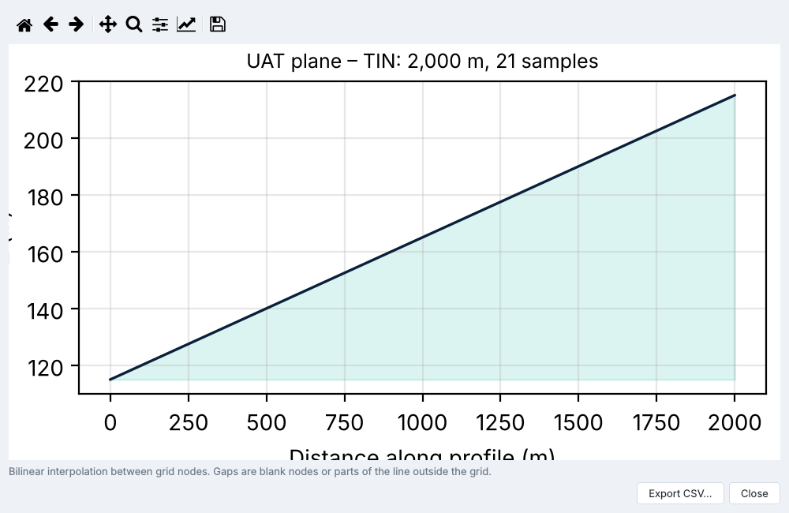

**GM-10 Clip.** Grid ▸ Clip Grid to Rectangle… on `UAT plane – TIN`, for example to
X 400500–401500, Y 2800500–2801000.

* Expected: a smaller grid (51 × 26 nodes for these limits at 20 m spacing) with
  the same values as the original at the same coordinates.

## 4.4 Maps and cartographic layout

**MAP-01 Contour map.** Select `UAT plane – TIN`. Mapping ▸ Contour Map.

* Expected (screenshot `uat_06`): a map page (A4 landscape) with straight,
  parallel, evenly spaced contour lines at 120, 140 … 220 m, running from
  north-north-west to south-south-east. The horizontal distance between lines is
  371 m (measure against the scale bar). Title, subtitle, north arrow, scale bar
  and coordinate labels are shown.

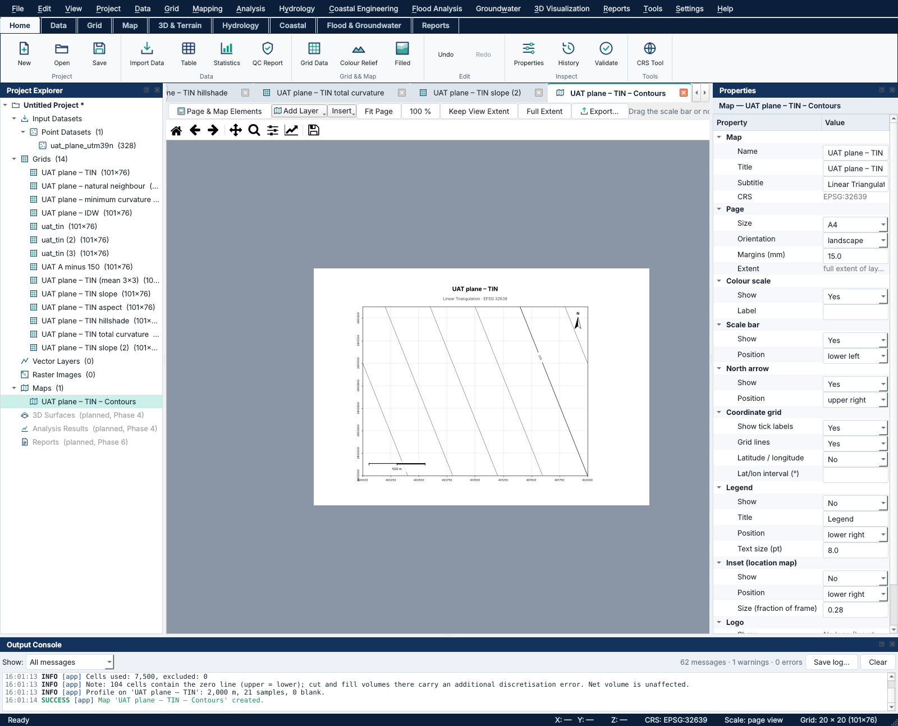

**MAP-02 Contour properties.** Click the contour layer in the Layers list. In
Properties set the interval to 10 m and show labels.

* Expected: twice as many lines, labelled. Edit ▸ Undo restores the previous
  interval.

**MAP-03 Colour relief and filled contours.** Select the slope grid from GM-04.
Mapping ▸ Colour Relief Map. Then Mapping ▸ Filled Contour Map on `UAT plane – TIN`.

* Expected: the slope is the same everywhere (3.0824947°), so the map should be
  one colour. **It is not** (screenshot `uat_07`): the colour scale stretches over
  the round-off differences between nodes, which are smaller than 10⁻¹⁰°, and
  draws them as a mottled pattern with labels such as 3.08249471. This is known
  issue K3 (§7.1); record it as seen, not as a new failure. The filled contour
  map of the TIN grid shows parallel colour bands, as expected.

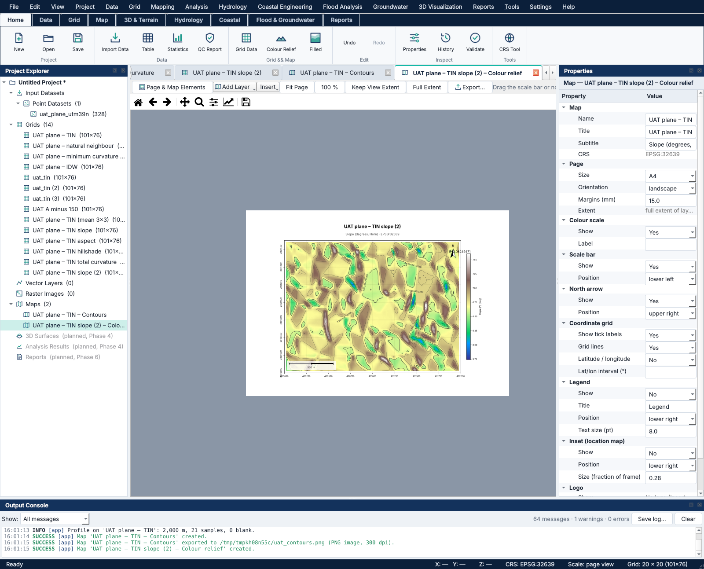

**MAP-04 Post map.** Select the UAT dataset. Mapping ▸ Post Map.

* Expected: 328 symbols coloured by Z, inside the plane's extent.

**MAP-05 Multiple layers.** On the contour map, Add Layer ▸ Post (the UAT dataset)
and Colour Relief (the TIN grid).

* Expected: three layers in the Layers list. Untick a layer: it disappears. Use ▲
  and ▼ to change order: drawing order follows. Set the colour relief opacity to
  0.5 in Properties: contours and points show through.

**MAP-06 Page elements.** Click **Page & Map Elements**. In Properties:
show the legend (title "Legend", lower right); show the inset location map; turn
on the latitude/longitude graticule; set page size A3.

* Expected: each change is drawn immediately. The legend lists the visible layers;
  the inset shows a larger area with the main map extent outlined; the graticule
  labels degrees and minutes: the map spans about 50° 00.4′ E to 50° 01.6′ E and
  25° 18.8′ N to 25° 19.6′ N. Drag the scale bar and north
  arrow with the mouse: they move and stay where dropped.

**MAP-07 Text box and logo.** Insert ▸ Text Box…, type `UAT test – not for
engineering use`. Insert ▸ Logo Image…, choose any PNG or JPEG under 2 MB.

* Expected: both appear on the page. Change the text-box size and position in
  Properties. Clearing the text deletes the box.

**MAP-08 Export for publication.** With the contour map open, File ▸ Export Map:

| Format | Settings | Expected |
|---|---|---|
| PNG | 300 dpi, A4 landscape | image of 3507 × 2480 pixels (A4 at 300 dpi, within one pixel), 300 dpi recorded in the file |
| TIFF | 300 dpi | LZW-compressed TIFF with 300 dpi recorded |
| PDF | – | vector PDF; in Adobe Reader, File ▸ Properties ▸ Fonts lists embedded TrueType fonts; text can be selected |
| SVG | – | opens in a web browser or Inkscape with sharp lines |
| JPEG | 150 dpi | smaller image, same content |

* Also: exporting again to an existing file name asks before overwriting.

## 4.5 GIS data: vectors, rasters and integration (new in v0.3.0)

Start a new project (File ▸ New Project, default CRS `EPSG:32639`). The files are
in `...\_internal\samples\data\gis\`.

**GIS-01 Vector import.** File ▸ Import Vector… for each file:

| File | Expected features | Geometry | Fields | CRS |
|---|---|---|---|---|
| `site_boundary.geojson` | 1 | Polygon | name, status | EPSG:4326 |
| `wadi_channels.shp` | 4 | LineString | name, order | EPSG:32639 (from the `.prj`) |
| `land_use.gpkg` | 14 | Polygon | class, runoff_coeff | EPSG:32639 |
| `boreholes.gpkg` | 40 | Point | bh_id, depth_m, water_level_mAMSL | EPSG:32639 |
| `flood_reports.geojson` | 420 | Point | severity | EPSG:4326 |

* Expected: each appears under **Vector Layers** in the explorer. Double-click
  opens Preview, Attributes and Information tabs.

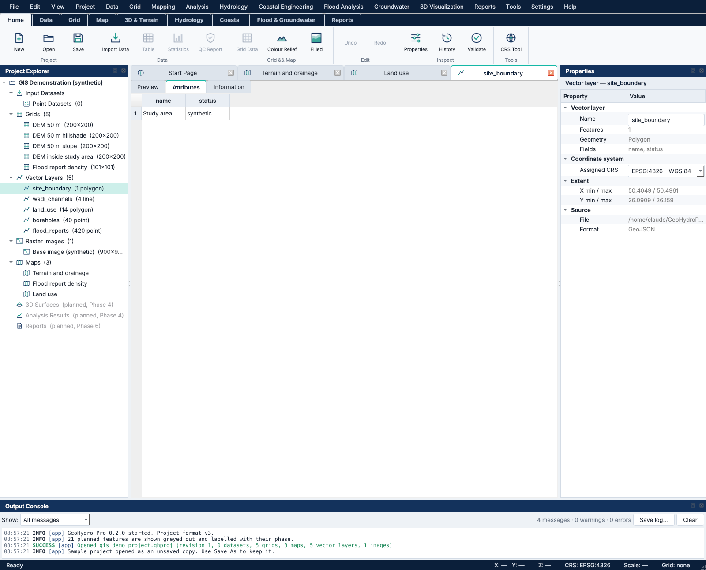

**GIS-02 Raster import.** File ▸ Import Raster…:

* `dem_50m_utm39n.tif`, Import as **Grid**. Expected: a grid of 200 × 200 nodes at
  50 m, EPSG:32639, Z 4.02 to 29.82 m, 0 blank nodes.
* `basemap_rgb_wgs84.tif`, Import as **Image**. Expected: an entry under
  **Raster Images**, CRS EPSG:4326. Images carry colours only; no calculation is
  offered on them.

**GIS-03 Buffer refused in degrees.** Select `flood_reports` (EPSG:4326). Data ▸
Vector Processing…, operation Buffer, distance 100.

* Expected: refused with the message *Buffering needs a projected CRS (distances in
  degrees are not lengths). Reproject the layer first.* No layer is created.

**GIS-04 Reproject.** Vector Processing on `flood_reports`, operation Reproject,
target `EPSG:32639`.

* Expected: a new layer `flood_reports (EPSG:32639)` with 420 features. The
  original layer is unchanged.

**GIS-05 Buffer, measures, dissolve.**

* Buffer `wadi_channels` by 50: new layer `wadi_channels buffer 50`, 4 polygons.
* Add area / length fields to `land_use`: new layer `land_use (measures)` with
  fields `area_m2` and `perim_m`; the areas add up to **100,000,000 m²** (100 km²).
* Dissolve `land_use` (all features): new layer `land_use dissolved` with 1
  feature.
* Edit ▸ Undo removes the last created layer; Edit ▸ Redo brings it back.

**GIS-06 Points to point dataset.** Data ▸ Vector Points to Point Dataset…,
layer `boreholes`, Z values from `water_level_mAMSL`.

* Expected: a point dataset `boreholes points` with 40 points, 0 excluded, Z from
  1.701 to 5.261 m. It can be gridded like any imported point file. (The dialog
  proposes the first numeric field, `depth_m`; choose `water_level_mAMSL`.)

**GIS-07 Point density.** Mapping ▸ Point Density…, points `flood_reports`
(EPSG:4326).

* Expected: refused: *Point density needs projected coordinates (a bandwidth in
  degrees is not a distance). Reproject the points first.*
* Repeat with `flood_reports (EPSG:32639)`, method kernel density, kernel quartic,
  bandwidth blank, rule Scott, 150 nodes on the long side, per km², create a map.
* Expected: grid `UAT flood density` (219 × 220 nodes; the grid is extended by the
  bandwidth around the points), Z unit *points per km²*, bandwidth about 639 m
  (Scott rule), maximum about 112 points/km². The density integrates to the number
  of points: 420 (measured 419.99). A density map is created.
* Repeat with method *point count per cell*, 50 nodes on the long side, not per
  km²: the counts add up to exactly **420**.

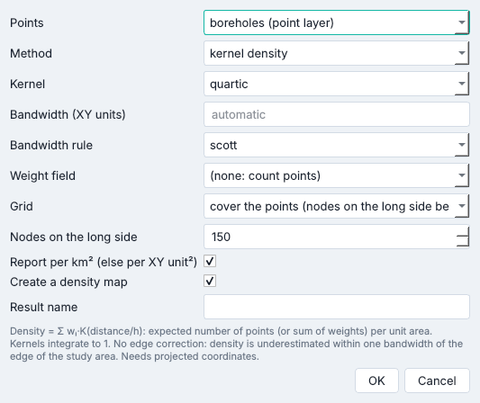

**GIS-08 Blank a grid with a polygon.** Grid ▸ Blank Grid with Polygons…, grid
`dem_50m_utm39n`, polygon layer `site_boundary`, blank nodes outside.

* Expected: grid `dem_50m_utm39n (blanked outside)` with 19,840 valid and 20,160
  blank nodes. The boundary is reprojected from EPSG:4326 automatically.

**GIS-09 Integrated map.** Make a colour relief map of the DEM. Add Layer ▸ the
base image (it goes to the bottom), `land_use` (fill), `wadi_channels`,
`boreholes` with labels from `bh_id`, and `site_boundary`.

* Expected: all layers line up. Layers in another CRS are reprojected on the fly
  and a note on the map says so. The legend lists them.

**GIS-10 Symbology.** Select the `land_use` layer. Properties: symbology
**categorized** by `class`, then **graduated** by `runoff_coeff` with 5 quantile
classes.

* Expected: one colour per land-use class with a legend entry each; then 5 classes
  with their value ranges in the legend.

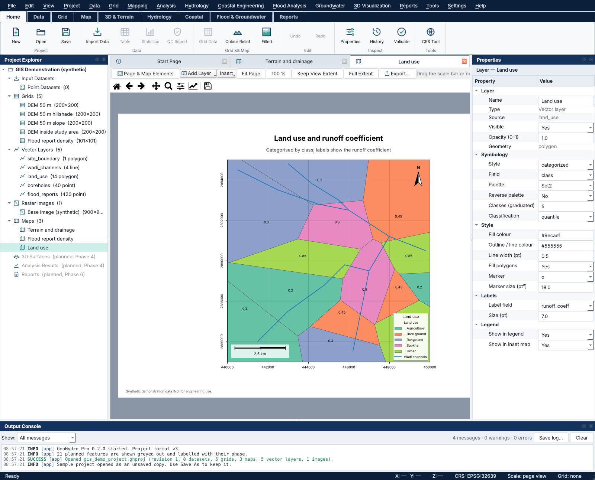

**GIS-11 GIS demo project.** File ▸ Open GIS Demo Project.

* Expected: maps *Terrain and drainage*, *Flood report density* and *Land use*;
  grids DEM 50 m, its hillshade and slope, *DEM inside study area* and *Flood report
  density*; five vector layers; one base image.

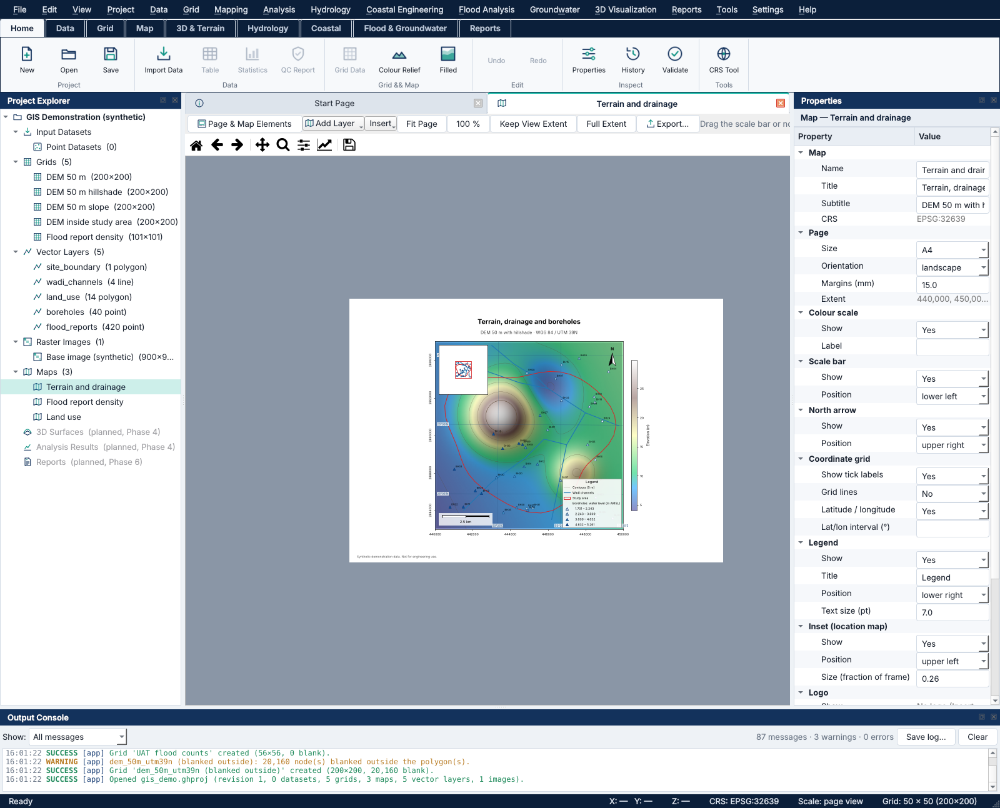

## 4.6 Undo, history and project files

**UND-01 Undo and redo.** In the UAT project create a map, then Edit ▸ Undo
(Ctrl+Z) and Edit ▸ Redo (Ctrl+Y).

* Expected: the Edit menu names the action (for example "Undo Create map"). Undo
  removes the map, redo restores it, and an open document is reopened. Up to 30
  actions can be undone.

**PRJ-01 Save and reopen.** Save the UAT project (File ▸ Save Project As…,
`UAT_v030.ghproj`). Close GeoHydro Pro and reopen the file.

* Expected: the same datasets, grids, maps, vector layers and images, with
  identical values. Project ▸ Validate Project reports no errors.

**PRJ-02 Processing history.** Project ▸ Processing History….

* Expected: every import, grid, calculation, map edit, export, undo and redo of
  the session is listed with time and parameters.

**PRJ-03 Older project files.** If you have projects saved by v0.1 or v0.2, open
one.

* Expected: it opens and shows as modified (upgraded to format v3 in memory). The
  file on disk is unchanged until you save; when saved, a `.bak` copy of the old
  file is kept.

**PRJ-04 Output console.** Use **Save log…** in the Output Console.

* Expected: a text file with all messages, warnings and errors of the session.
  Attach it to your report.

## 4.7 Planned features are disabled and labelled

**PLN-01** Open the Hydrology, Coastal Engineering, Flood Analysis, Groundwater,
3D Visualization and Reports menus, and Data ▸ Import NetCDF / Import Point Cloud.

* Expected: every item is greyed out and labelled *(planned, Phase N)*. None of
  them does anything.

**PLN-02** Help ▸ Feature Checklist.

* Expected: the checklist opens and matches §6.

# 5. Expected outputs (summary)

| ID | Quantity | Expected value | Tolerance |
|---|---|---|---|
| IMP-01 | points imported / excluded | 328 / 0 | exact |
| IMP-02 | Z min / max | 100.0000 / 230.0000 m | exact |
| IMP-03 | rows imported / excluded / duplicate groups | 35 / 5 / 2 | exact |
| IMP-04 | stations points / out of range | 49 / 1 | exact |
| GRD-01 | nodes, blank | 101 × 76, 0 | exact |
| GM-01 | Z min / max of A − 150 | −50 / 80 m | 10⁻⁶ m |
| GM-02 | TIN − minimum curvature | 0 | 10⁻⁶ m |
| GM-02 | TIN − re-imported grid files | 0 | exact |
| GM-04 | slope | 3.08249° | 10⁻⁵° |
| GM-05 | aspect | 248.1986° | 10⁻⁴° |
| GM-06 | hillshade (315°, 45°) | 183.87 | 0.01 |
| GM-07 | curvature | 0 | 10⁻¹² |
| GM-08 | volume above 0 | 495,000,000 m³ | 1 m³ |
| GM-08 | net volume above 150 | 45,000,000 m³ | 1 m³ |
| GM-08 | surface area | 3,004,346.85 m² | 0.01 m² |
| GM-09 | profile length, Z ends | 2,000 m; 115 m → 215 m | 10⁻⁶ |
| MAP-01 | contour spacing (20 m interval) | 371 m | by eye against scale bar |
| MAP-08 | PNG A4 landscape at 300 dpi | 3507 × 2480 px | ±1 px |
| GIS-01 | features per layer | 1, 4, 14, 40, 420 | exact |
| GIS-02 | DEM grid | 200 × 200, 50 m, Z 4.02–29.82 m | 0.01 m |
| GIS-05 | land-use total area | 100,000,000 m² | 1 m² |
| GIS-07 | density integral / counts total | ≈ 420 / 420 | 0.1 % / exact |
| GIS-08 | valid / blank nodes | 19,840 / 20,160 | exact |

# 6. Implemented versus planned features

**Implemented in v0.3.0 (to be tested above)**

| Area | Features |
|---|---|
| Data import | CSV, TXT, DAT, XYZ, Excel; delimiter, decimal and encoding detection; quality control with reasons for every excluded row; duplicates; CRS assignment; units |
| Gridding | IDW, Ordinary and Universal Kriging (genuine geostatistical Kriging with variogram), minimum curvature, natural neighbour, nearest neighbour, linear triangulation, radial basis functions; variogram analysis; cross-validation; Surfer and ESRI grid files, GeoTIFF |
| Grid math | calculator (A–D), filters, slope, aspect, hillshade, curvature, profiles, volumes and cut/fill, polygon blanking, clipping |
| GIS data | vector import/export (Shapefile, zipped Shapefile, GeoJSON, GeoPackage, KML/KMZ, FlatGeobuf), vector processing (reproject, buffer, clip, dissolve, area/length, repair), geodesic measures, raster import as grid or image |
| Density | kernel density (5 kernels), point counts, weights |
| Maps | contour, filled contour, colour relief, post, vector and image layers; visibility, order, opacity; single, categorized and graduated symbology; legend, north arrow, scale bar, coordinate grid, lat/lon graticule, inset, text boxes, logo; PNG, JPEG, TIFF, PDF, SVG export |
| Editing and projects | undo/redo (30 steps), processing history, project validation, project format v3 with migration from v1/v2 |
| Windows | installer, portable zip, self-test, sample and GIS demo projects |

**Offered but not covered by automated tests**: reading GML, DXF, GPX and MapInfo
files through GDAL. Test them if you have such files and report the result.

**Planned (not in v0.3.0; disabled in the program)**

| Item | Planned for |
|---|---|
| Several independent map frames on one page; interactive annotation drawing tool; map templates | later phase |
| Web tile base maps (OpenStreetMap, satellite) | later phase |
| LAS/LAZ point clouds, 3-D surfaces and 3-D point views | Phase 4 |
| Depression filling, D8 flow direction, flow accumulation, streams, watersheds | Phase 4 |
| Shoreline baselines, transects, change rates, beach profiles | Phase 5 |
| Flood susceptibility screening, stormwater, groundwater and water-quality surfaces, NetCDF, PDF/Excel reports | Phase 6 |
| Accounts, cloud sync, licensing, web application | Phase 7 |
| Arabic interface, code signing, formal validation campaign | Phase 8 |

# 7. Known limitations and troubleshooting

## 7.1 Known issues in v0.3.0

| # | Issue | Effect | Status |
|---|---|---|---|
| K1 | **Natural neighbour, nodes exactly on the convex hull of the data.** A near-collinearity test uses an exact zero comparison; with rounding, one boundary node in the UAT grid gets a wrong weight (error 0.19 m on a plane; all interior nodes exact). Found while preparing this guide. | Small errors at isolated nodes on the outer boundary of the data | to be fixed in v0.3.1 |
| K2 | The Undo and Redo buttons in the ribbon's Home tab have no icon (text only). | Cosmetic | v0.3.1 |
| K3 | **Colour scale of a (nearly) constant grid.** Automatic colour limits use the exact minimum and maximum, so on a grid whose values differ only by round-off (for example the slope of a plane) the colours show meaningless patterns. Found while preparing this guide. | Misleading picture for constant or near-constant grids; values themselves are correct | v0.3.1: treat a range below a relative threshold as constant |
| K4 | The UAT dataset is not in the v0.3.0 installer. | Download it separately (§3) | included from the next build |
| K5 | Not code-signed. | SmartScreen and some antivirus programs warn | needs a paid certificate |
| K6 | Tested only on Windows Server build machines before this UAT. | This test is the first desktop check | this UAT |

## 7.2 Documented limitations (behaviour by design)

* IDW does not reproduce planes or trends; use linear triangulation, natural
  neighbour, minimum curvature or Universal Kriging for that.
* Terrain derivatives leave the outer ring of nodes blank. Aspect on projected
  grids is relative to grid north, not true north.
* Cut and fill volumes carry a small error where the surfaces cross; the net
  volume does not (a warning gives the number of cells).
* Simpson 3/8 can be less accurate than Simpson 1/3 when the number of intervals
  is not a multiple of 3. Simpson 1/3 is recommended.
* Kernel density has no edge correction.
* Clip keeps attributes unchanged; they are not apportioned by area.
* Surfer grid formats are tested by round trip but not yet against files written
  by Surfer itself. If you have Surfer, open a `.grd` exported by GeoHydro Pro in
  Surfer and report the result.
* Ordinary Kriging on the smooth synthetic terrain sample understates its
  variance (MSSE ≈ 8.7), documented in `docs/GRIDDING.md`.
* All sample data are synthetic.

## 7.3 Troubleshooting

| Symptom | What to do |
|---|---|
| "Windows protected your PC" | Unsigned build. More info ▸ Run anyway (§1). |
| Antivirus quarantines files | Restore them and add an exclusion for the installation folder; report the antivirus product and version. |
| Program does not start, or the window flashes and closes | Run the self-test (INS-04); a `FAIL` line names the missing component. Reinstall. |
| Blank or black window | Update the graphics driver. Workaround: set the environment variable `QT_OPENGL=software` and start again. |
| Text too small or clipped | Check Windows display scaling; restart GeoHydro Pro after changing it. Record it as a finding. |
| Import shows "no coordinate reference system" | The `.prj` is missing or the CRS was not set; assign it in the Properties panel (metadata only, coordinates are not moved). |
| Buffer or point density refused | The data are in longitude/latitude; reproject first (GIS-03, GIS-07). |
| A raster opened as an image | Re-import with *Import as: Grid*. |
| "This project was created with a newer version" | The file was saved by a newer GeoHydro Pro. |
| Anything else | Save the console log (PRJ-04), take a screenshot, note the test ID and steps, and record it in the report. |

# 8. Acceptance report template

The template is a separate, editable file: `UAT_REPORT_TEMPLATE_v0.3.0.docx`
(also as Markdown in the repository, `docs/uat/UAT_REPORT_TEMPLATE_v0.3.0.md`).
It lists every test ID of §1, §2 and §4 with columns for result, actual value
and notes, a defect log, and the acceptance decision.

**Suggested acceptance criteria**

* All installation tests (INS) and project-file tests (PRJ) pass.
* Every exact value in §5 is matched within its tolerance.
* No Fail of severity *Critical* or *Major* is open (severity definitions are in
  the template).
* Known issues K1 to K6 do not count as new failures, but please note if you see
  them.
